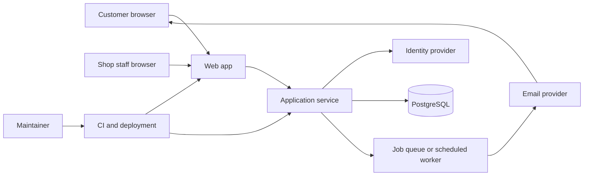

# Reference architecture: repair-shop appointments and waitlist

**Maturity:** reviewed teaching example; fictional scenario, not a tested implementation.

This example follows an independent builder making a small SaaS for neighborhood device and bicycle repair shops. A shop publishes service types and available appointment windows; customers request a booking; staff confirm or reschedule; the product sends reminders and provides a daily work queue.

The scenario is hypothetical. It does not claim that repair shops have this need or that any listed stack is validated with buyers.

## Product boundary and assumptions

**Users:** shop owner/admin, staff member, customer booking a repair. **Buyer:** shop owner. **Core outcome:** reduce appointment coordination and no-show effort while keeping staff in control of capacity.

Initial scope excludes card processing, repair diagnosis, parts inventory, staff payroll, SMS marketing, and integrations with point-of-sale systems. Collect only the customer's name and one contact method, requested service, selected slot, and optional short note. The note is plain text and should discourage sensitive information.

### Requirements

| Type | Requirement |
|---|---|
| Functional | Shop setup; service duration; available slots; booking request; staff confirm/reschedule/cancel; customer notification; daily list |
| Tenant boundary | Each shop can view/change only its configuration, bookings, customers, and staff |
| Correctness | A slot cannot be double-confirmed; timestamps and shop time zone remain unambiguous |
| Privacy | Purpose, retention, processor list, export/deletion, and contact route are visible and operable |
| Availability | Staff can see today's confirmed work; clear manual fallback if the app or email provider is down |
| Operability | One maintainer can deploy, observe, back up, restore, and disable notifications |

## Context and request path



Treat the identity provider and mail provider as separate trust boundaries. The application owns authorization and slot invariants; email delivery is best-effort and cannot silently change booking state.

## Small, understandable component design

Start with one modular application and one relational database. Use modules for identity/tenant access, shop/service settings, availability, booking state, and notifications. Separate modules in code; do not split into microservices without an operational reason. A background worker can begin as a scheduled job in the same deployable if volume is low.

Suggested records:

| Entity | Important fields and rule |
|---|---|
| Shop | `id`, display name, IANA time zone, retention policy; tenant root |
| Membership | `shop_id`, `user_id`, role; every staff access resolves through this relation |
| Service | `shop_id`, duration, active flag; duration is validated and versioned |
| Availability | `shop_id`, local schedule, exceptions; convert using stored IANA zone |
| Booking | `shop_id`, service, contact, UTC start/end, status, version, timestamps |
| Notification job | booking/version, recipient, attempt count, status; avoid duplicate sends on retry |
| Audit event | actor, shop, action, record ID, timestamp; exclude message/note content by default |

Use database constraints and a transaction to prevent overlapping confirmed bookings for the same staff/resource where supported. Protect against duplicate customer submissions with an idempotency key. Treat webhooks and background retries as at-least-once delivery.

## Booking lifecycle

```text
requested → confirmed → completed
     ↘         ↘
      cancelled ← rescheduled
```

The state transition is authorized in server code and recorded. Rescheduling reserves the new slot atomically, then queues a notification. If email fails, the booking remains confirmed and staff can retry or contact the customer. Display notification status so the operator does not mistake an undelivered email for a cancelled appointment.

## Security and privacy

- Resolve a shop membership for every staff request; do not trust a `shop_id` supplied by the browser.
- Enforce tenant filters in the database access layer and add cross-tenant negative tests before a real launch.
- Use hosted identity rather than custom password handling; require strong admin authentication and rate-limit public booking.
- Validate service IDs, time zones, intervals, message size, and booking state transitions.
- Use TLS, managed secrets, least-privilege database credentials, backups, and dependency updates.
- Keep customer notes optional, short, and free of sensitive diagnostic/payment data; set a retention period and deletion workflow.
- Make public booking abuse controls proportionate (rate limits, challenge only when necessary, duplicate detection).

Use [OWASP ASVS](https://asvs.owasp.org/) to select requirements for the application's risk and [NIST SSDF](https://csrc.nist.gov/pubs/sp/800/218/final) for secure delivery practices. Neither is a certification from this example.

## Deploy and operate

Use a managed application host and managed PostgreSQL for the first release unless a verified need requires more control. Keep staging and production separate. Run additive migrations, deploy an immutable revision, smoke-test booking and staff confirmation, then inspect errors and notification queue. Disable outbound email in test environments.

Measure monthly:

- booking request success and confirmed-slot conflicts;
- p95 time for the core booking interaction;
- notification enqueue/delivery/failure rates;
- backup completion and last successful restore drill;
- support requests, cancellation/reschedule rate, and customer-reported no-show issues.

Set an SLO only after measuring baseline and agreeing what users need. Choose backup RPO/RTO with the shop, and practice restore into an isolated database. During an incident, pause booking or notifications with a clear banner and give shops an export/manual process.

## Cost model and scale path

No vendor quote is assumed. Estimate monthly cost as:

`application hosting + database baseline/storage/backups + email volume + logs/monitoring + domain + payment (if later added) + maintenance time`

At low volume, avoid adding a cache, search cluster, event bus, or AI model. If volume grows, first add indexes and query measurements, then a durable queue for notifications, then read replicas or service separation only when a measured bottleneck or isolation need justifies the extra on-call burden.

## Alternatives considered

| Choice | Why it was not the default |
|---|---|
| Shared calendar + form | May be sufficient; validate this baseline before building a product |
| Spreadsheet workflow | Cheapest; lacks robust concurrency and tenant boundaries if shared broadly |
| Microservices + Kubernetes | More deployment, observability, and failure modes than one solo operator needs |
| AI scheduling assistant | Adds privacy and evaluation burden; deterministic availability rules are clearer |
| Store card details and charge deposits | Expands security, payment, refund, and regulatory scope; defer to a hosted payment provider if validated |

## Decisions to adapt

Before implementing a real product, validate shop workflow and willingness to pay, review privacy/consumer obligations for target locations, test daylight-saving transitions, establish tenant-isolation tests, clarify email consent rules, and rehearse restore and cancellation. Use [the stack comparison matrix](../../12-stack-combinations/README.md) and [architecture decision record](../../templates/ARCHITECTURE_DECISION_RECORD.md) to record changes.
