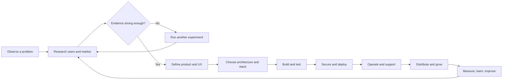

  
  <h1>SoloFoundry</h1>
  
<strong>Build with knowledge. Craft with purpose.</strong>

  
An open-source workshop for independent builders, from first problem evidence to a product you can operate.

  
  
  
  

<a href="#start-here">Choose a learning path</a> · <a href="ROADMAP.md">Roadmap</a> · <a href="CONTRIBUTING.md">Contribute</a> · <a href="CODE_OF_CONDUCT.md">Community standards</a>

---

## What is SoloFoundry?

SoloFoundry is a documentation-first, open-source workshop for independent developers and small teams who want to take a product from an observed problem to a useful, secure, sustainable product. It connects discovery, design, engineering, AI, security, deployment, operations, growth, and business fundamentals.

It is not a boilerplate, a tool directory, or a promise that one person should become an expert in every discipline. It helps builders make informed decisions, study authoritative resources, practice with reusable templates, recognize risks, and know when specialist help is needed.

## The product-building journey

## Explore the workshop

| Area | What it helps you do |
|---|---|
| [00 · Foundations](00-foundations/) | Learn the independent-builder mindset and decision principles. |
| [01 · Discover](01-discover/) | Find painful problems, understand users, assess markets, validate demand. |
| [02 · Design](02-design/) | Turn evidence into product scope, workflows, UX and accessible interfaces. |
| [03 · Engineer](03-engineer/) | Build frontend, backend, APIs, data systems and architectures. |
| [04 · AI](04-ai/) | Design LLM, RAG, agent, evaluation and inference systems responsibly. |
| [05 · Secure](05-secure/) | Threat-model and protect products, data, identities and supply chains. |
| [06 · Deploy](06-deploy/) | Ship through cloud, containers, CI/CD, networking and infrastructure as code. |
| [07 · Operate](07-operate/) | Monitor, support, back up, respond to incidents and improve reliability. |
| [08 · Grow](08-grow/) | Position, distribute, market, measure acquisition and retain users. |
| [09 · Business](09-business/) | Understand pricing, billing, finance, legal basics and business models. |
| [10 · Industry playbooks](10-industry-playbooks/) | Apply the lifecycle to real industry problem spaces. |
| [11 · Reference architectures](11-reference-architectures/) | Study end-to-end architectures with explicit trade-offs. |
| [12 · Stack combinations](12-stack-combinations/) | Compare coherent technology combinations for specific constraints. |
| [Templates](templates/) | Reusable canvases, checklists, experiment logs and decision records. |
| [Resources](resources/) | Curated docs, standards, research, courses and repositories. |

## How SoloFoundry is different

A link collection tells you what exists. SoloFoundry aims to explain **how to decide, why a choice fits, what it connects to, and what can go wrong**.

Every substantial guide should connect: problem → requirements → architecture → components → implementation → security → deployment → operations → cost → product and business outcomes.

## Guide quality standard

Each guide should answer, where relevant:

1. What problem does this solve, and for whom?
2. When should you use it—and when should you avoid it?
3. What concepts and prerequisites matter?
4. How do the components interact? Include a diagram where useful.
5. What are the viable approaches, tools and alternatives?
6. What assumptions, trade-offs, costs and maintenance burdens apply?
7. What security, privacy, accessibility and reliability concerns apply?
8. How can a builder implement and test it?
9. What can fail in production, and how is it diagnosed?
10. What evidence, official documentation, standards, repositories or research support the guide?
11. What checklist or decision record should the reader leave with?

Use the [guide template](templates/GUIDE_TEMPLATE.md). Mark maturity honestly: `draft`, `reviewed`, or `tested`. Never label an example production-ready without evidence.

## Principles

- **Craft over shortcuts:** explain mechanisms, not just recipes.
- **Evidence over hype:** prefer primary sources, standards and reproducible examples.
- **Independence over dependency:** teach decision-making, not blind tool adoption.
- **Simplicity over complexity:** choose the least complex system that meets real requirements.
- **Depth over link volume:** curated references must have context and a reason to exist.
- **Practice over theory:** connect concepts to experiments, implementation and verification.
- **Safety by design:** security, privacy, accessibility and reliability are not afterthoughts.
- **Honest uncertainty:** distinguish facts, assumptions, recommendations and experience.

## Start here

If you have an idea, begin with [Problem Discovery](01-discover/problem-discovery/README.md), then use the [Opportunity Assessment](templates/OPPORTUNITY_ASSESSMENT.md) and [Experiment Log](templates/EXPERIMENT_LOG.md). Do not start by selecting a framework.

If you already have a product, start with the relevant engineering, security, deployment or operations guide and work backwards to identify missing evidence.

### Learning paths

- **I have an idea:** follow [the opportunity discovery path](01-discover/README.md), from problem signals to a build, pivot, pause, or reject decision.
- **I am shaping a product:** start with [Product Design](02-design/README.md), then work through engineering, security, deployment, and operations.
- **I already have a product:** use the relevant lifecycle area as an audit path; check its status in [Content Status](CONTENT_STATUS.md) before treating an outline as a complete guide.
- **I build for a specific industry:** use the [industry playbooks](10-industry-playbooks/README.md) to surface role, data, safety, adoption, and compliance questions before choosing a stack.
- **I need to choose an architecture or stack:** read the [worked reference architecture](11-reference-architectures/repair-shop-appointments/README.md) alongside [stack combinations](12-stack-combinations/README.md).
- **I am preparing to launch or charge:** work through [growth](08-grow/README.md) and [business](09-business/README.md), then validate assumptions with real users and local specialists.

SoloFoundry is being built in reviewable phases. A folder or planned topic is not evidence that a guide exists. The current phase and remaining lifecycle coverage are tracked in [the roadmap](ROADMAP.md) and [content status](CONTENT_STATUS.md).

## Contributing

Contributions are welcome: corrections, tested examples, architecture diagrams, industry research, reference updates and better learning paths. Read [CONTRIBUTING.md](CONTRIBUTING.md), the [source evaluation policy](resources/SOURCE_EVALUATION.md), and the [community code of conduct](CODE_OF_CONDUCT.md) first.

## Status and roadmap

This is an evolving knowledge base with lifecycle guides, practice labs, industry playbooks, a worked reference architecture, and searchable documentation-site configuration. See [ROADMAP.md](ROADMAP.md) for delivery and maintenance gates and [CONTENT_STATUS.md](CONTENT_STATUS.md) for coverage and validation limits. No guide implies real-world demand, compliance, or production readiness unless evidence is explicitly documented.

If this workshop helps you build or teach, consider [starring the repository](https://github.com/Chandanrohit/SoloFoundry). A star is useful as a discovery signal; it is not evidence that a method or product has been validated.

## License

Original educational documentation and diagrams use **Creative Commons Attribution 4.0 International (CC BY 4.0)**. Original code examples and software use the **MIT License** in [LICENSE](LICENSE). Third-party material remains under its own license; see [LICENSES.md](LICENSES.md).

---

SoloFoundry · Learn the craft. Understand the systems. Build independently.

